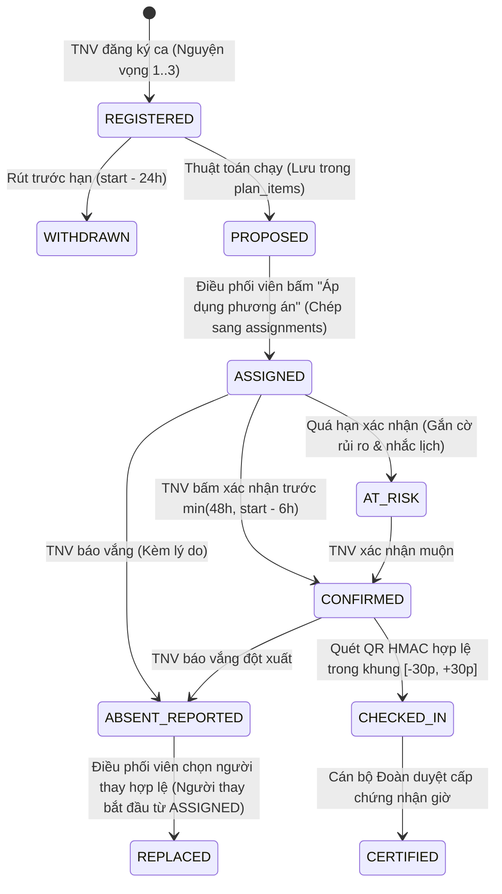
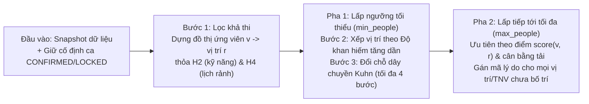
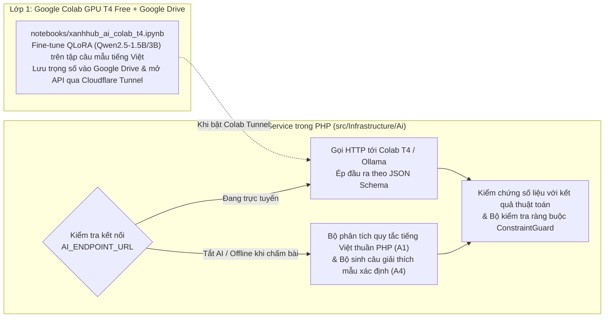
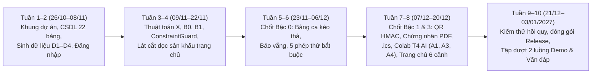

# Kế hoạch đề tài 6 – Xanh Hub: Hệ thống tổ chức hoạt động và phân công tình nguyện viên (Phiên bản chuẩn v1.1)

20/10/2026 · Nhóm phát triển Xanh Hub (3 thành viên: Vai A, Vai B, Vai C)

## 1. Tổng quan

**Xanh Hub** là hệ thống web mã nguồn mở giúp Đoàn – Hội tổ chức hoạt động tình nguyện: tiếp nhận đăng ký, tự đề xuất phân công theo đồng thời kỹ năng, thời gian và số người mỗi ca, hỗ trợ thay người khi có thành viên báo vắng hoặc đổi lịch, điểm danh bằng mã QR và cấp chứng nhận giờ tình nguyện. Khẩu hiệu của sản phẩm: **Đúng người. Đúng ca. Đúng giờ.**

Bản kế hoạch **v1.1** này đã đối chiếu từng dòng với đề bài gốc **Đề tài 6** trong tài liệu học phần *Phát triển phần mềm mã nguồn mở* (`DE_TAI_BTL.docx`) và hợp nhất toàn bộ các hiệu chỉnh kỹ thuật (T1–T9, D1–D6, N1–N6, M1–M2), bảng màu đạt chuẩn tương phản WCAG AA, cùng kiến trúc huấn luyện AI trên Google Colab T4.

### Mục tiêu đo được

- **Đạt 5/5 nhóm chức năng, 2/2 yêu cầu kỹ thuật và 5/5 phép thử bắt buộc** của Đề tài 6; bổ sung bộ kiểm thử tự động và kiểm thử theo thuộc tính ngẫu nhiên (property-based testing).
- **So sánh thuật toán trung thực (KT2):** Trên cùng dữ liệu và hạt ngẫu nhiên cố định, phương án của Xanh Hub (`X`) so với cách gán theo thứ tự đăng ký thuần (`B0`) và theo thứ tự đăng ký có kiểm tra (`B1`): đạt **0 vi phạm ràng buộc cứng**, tỷ lệ ca đủ người hợp lệ cao hơn hoặc bằng `B1`, và độ lệch chuẩn số ca giữa các tình nguyện viên ở chế độ *Công bằng* giảm từ **40% trở lên** so với `B1`.
- **Triển khai linh hoạt & tái lập 100%:** Chạy trực tiếp siêu nhẹ trên máy phát triển (`PHP 8.2+` & `PostgreSQL 18`) hoặc khởi chạy bằng một lệnh `docker compose up` với dữ liệu mẫu `D1–D4` tự nạp.
- **Tiếp cận & Hiệu năng giao diện:** Đạt Lighthouse Accessibility $\ge 90$, mọi cặp màu chữ/nền đạt chuẩn tương phản WCAG AA ($\ge 4,5:1$), tôn trọng `prefers-reduced-motion`, và hỗ trợ đầy đủ thao tác bàn phím.

### Nguyên tắc chống "tính năng rác" & Quản trị phạm vi theo bậc

Mỗi tiện ích thêm ngoài đề bài phải trả lời được ba câu hỏi: *ai dùng*, *dùng vào lúc nào*, *kiểm thử bằng cách nào*. Để đảm bảo tiến độ cho nhóm 3 thành viên trong 10 tuần, phạm vi dự án được chia thành các bậc mở khóa có điều kiện:

| Bậc | Nội dung | Hạn hoàn thành | Điều kiện mở khóa |
| :--- | :--- | :--- | :--- |
| **Bậc 0. Lõi chấm điểm (Bắt buộc)** | CN1–CN5, KT1–KT2, dữ liệu `D1–D3` (và `D4`), an toàn cơ bản (kiểm quyền máy chủ, CSRF, Argon2id, ràng buộc PostgreSQL), 5 phép thử bắt buộc, Docker, README, giao diện làm việc (bảng ca kéo thả, phòng thuật toán) | **06/12/2026** | Bắt đầu ngay từ Tuần 1 |
| **Bậc 1. Mở rộng giá trị cao** | Sổ giờ & chứng nhận PDF có mã xác thực; Check-in QR HMAC 30s; Xuất lịch `.ics`; Bảng công bằng & Nhật ký kiểm toán chuỗi mã băm; Hàng chờ dự bị & Xếp hạng người thay (`A3`); Trợ lý tạo ca tiếng Việt (`A1`) & Giải thích bằng lời (`A4`) huấn luyện trên Google Colab T4 kèm bộ dự phòng thuần PHP | **20/12/2026** | Bậc 0 qua toàn bộ phép thử; mốc giữa chặng 29/11 đạt ít nhất 3/5 nhóm chức năng |
| **Bậc 2. Mở rộng có điều kiện** | Nhắc lịch tự động, nhập CSV có báo lỗi từng dòng, cảnh báo thời gian đệm di chuyển, điểm rủi ro vắng theo quy tắc (`A2`), mốc giờ tình nguyện, đánh giá sau hoạt động (`A6`), TOTP 2 bước, song ngữ Việt – Anh | Sau 20/12 (nếu kịp) | Bậc 1 hoàn tất, CI xanh |
| **Bậc 3. Trải nghiệm điện ảnh** | Trang chủ 6 cảnh trên một sân khấu Canvas cố định đọc JSON thật của bộ `D3` (chuyển từ hỗn loạn `B0` sang trật tự `X` khi cuộn) kèm bản tĩnh dự phòng | Lát cắt dọc ở Tuần 3; hoàn thiện trước **20/12/2026** | Giao diện làm việc đã chốt và đạt ngân sách hiệu năng ($\ge 55\text{ fps}$) |

> [!IMPORTANT]
> **Danh sách cắt khỏi bản nộp** (để bảo vệ chất lượng lõi): PWA check-in offline, gợi ý hoạt động (`A5`), hỏi đáp dữ liệu tự do (`A7` – rủi ro chèn lệnh cao, lợi ích nhỏ), bản đồ nhiệt lịch rảnh 3D, và Server-Sent Events (thay bằng polling nhẹ của `htmx`).

---

## 2. Đối chiếu từng dòng với Đề gốc (`DE_TAI_BTL.docx`) và Phần làm vượt

Bảng dưới đây đối chiếu trực tiếp từng yêu cầu của **Đề tài 6** (mục 1 đến mục 7 trong `DE_TAI_BTL.docx`):

| Yêu cầu gốc trong `DE_TAI_BTL.docx` | Xanh Hub đáp ứng ở Bậc 0 (Đủ điểm tối đa) | Phần làm vượt ở Bậc 1–3 |
| :--- | :--- | :--- |
| **CN1.** Quản lý hồ sơ, kỹ năng, lịch rảnh, hoạt động và số người cần cho từng ca | CRUD đầy đủ; lịch rảnh theo khung 30 phút và ngày bận đột xuất (`availability_overrides`); mỗi ca khai báo khoảng giờ `tstzrange`, số người tối thiểu/tối đa (`min_people`, `max_people`) và các vị trí kỹ năng (`shift_requirements`) kèm cấp tối thiểu 1–5 | Cờ yêu cầu kỹ năng đã xác minh (`require_verified`), lịch rảnh lặp theo tuần, nhân bản hoạt động, nhập CSV có báo lỗi từng dòng |
| **CN2.** Cho tình nguyện viên đăng ký, rút đăng ký và xem ca được phân công | Đăng ký theo từng ca (chọn nguyện vọng 1–3) kèm nút *"Đăng ký nhanh mọi ca hợp lịch rảnh"*; cảnh báo ngay nếu trùng giờ hoặc ngoài lịch rảnh; rút đăng ký trước hạn chót (24 giờ trước giờ bắt đầu); trang *"Ca của tôi"* | Xuất lịch cá nhân `.ics`, hàng chờ dự bị tự động (`waitlist`) khi ca đầy |
| **CN3.** Đề xuất phân công theo các điều kiện và thứ tự ưu tiên; chỉ rõ người hoặc ca chưa bố trí được | Thuật toán heuristic 3 bước xét đồng thời kỹ năng, thời gian và số người mỗi ca (chia 2 pha `min_people` → `max_people`); tách rõ danh sách ca/vị trí thiếu người và TNV chưa được gán kèm 8 mã lý do chuẩn hóa | Ba chế độ trọng số (*Đủ người nhất*, *Công bằng*, *Theo nguyện vọng*), giải thích phương án bằng lời (`A4`), giữ cố định các phân công đã xác nhận/khóa khi chạy lại |
| **CN4.** Cho người điều phối sửa phân công; vẫn kiểm tra trùng lịch, thiếu kỹ năng và vượt số người mỗi ca | Bảng ca kéo thả dùng chung bộ kiểm tra ràng buộc (`ConstraintGuard`) ở máy chủ: chặn cứng 100% trùng giờ (`H1`), thiếu kỹ năng (`H2`), vượt số người (`H3`); cảnh báo mềm cho phép ghi đè kèm lý do với ngoài lịch rảnh (`H4`) và vượt số ca/tuần (`H5`) | Khóa/mở khóa ca đã chốt kèm lý do, hoàn tác, nhật ký kiểm toán chuỗi mã băm bất biến (`audit_log`) |
| **CN5.** Xác nhận tham gia, thay người vắng; thống kê ca đủ hoặc thiếu người và xuất danh sách | Xác nhận tham gia trước hạn chót `min(48h, start - 6h)` (quá hạn gắn cờ rủi ro `AT_RISK`); luồng báo vắng tự mở chỗ trống và lọc ứng viên thay thế hợp lệ; thống kê ca đủ/thiếu, tỷ lệ lấp đầy, độ lệch số ca; xuất CSV/PDF | Xếp hạng người thay thế có giải thích (`A3`), Check-in bằng mã QR xoay vòng HMAC 30 giây, sổ giờ tình nguyện và chứng nhận PDF có mã xác thực công khai |
| **KT1.** Thuật toán xét đồng thời kỹ năng, thời gian và số người mỗi ca; không gán theo thứ tự mà bỏ qua điều kiện | Thuật toán 2 pha × 3 bước thuần PHP trong `src/Domain/Scheduling/XanhHubScheduler.php` (Lọc khả thi → Gán theo độ khan hiếm → Chuỗi đổi chỗ Kuhn tối đa 4 bước) | Minh họa trực quan trên sân khấu Canvas trang chủ và sơ đồ giải thích từng bước với ví dụ số nhỏ **Linh – Phúc** |
| **KT2.** So sánh phương án của nhóm với cách gán theo thứ tự đăng ký trên cùng dữ liệu (tỷ lệ ca đủ người, số vi phạm, mức chênh lệch số ca) | Chạy đồng thời `B0` (thứ tự đăng ký thuần), `B1` (thứ tự đăng ký có kiểm tra) và `X` (Xanh Hub) trên cùng snapshot dữ liệu (lưu mã băm SHA-256 và cấu hình JSON); báo cáo cả *Đủ theo đầu người* và *Đủ hợp lệ*, số vi phạm theo từng loại và độ lệch chuẩn số ca | Biểu đồ trực quan trong Phòng thuật toán, bộ dữ liệu lớn `D4` (300 TNV, 60 ca, 12 kỹ năng) để đo tốc độ thực thi |
| **Dữ liệu & An toàn (1,0đ)** | 3 bộ dữ liệu chuẩn (`D1` đủ người, `D2` thiếu người, `D3` trùng lịch nhiều: 30 TNV, 12 ca, 5 kỹ năng); phương án lưu gắn đúng mã băm `dataset_snapshots`; kiểm tra quyền điều phối và mọi thay đổi lịch ở máy chủ | Ràng buộc `EXCLUDE USING gist` và trigger khóa dòng `FOR UPDATE` ngay tại tầng PostgreSQL; mật khẩu Argon2id, CSRF guard |
| **Kiểm thử & Sửa lỗi (1,5đ)** | Đủ 5 phép thử bắt buộc mục 6 của đề với dữ liệu vào cố định và đáp án kỳ vọng viết tay; kiểm thử tự động/tích hợp và hồi quy lỗi (`docs/BUGS.md`) | Kiểm thử theo thuộc tính ngẫu nhiên (Property-based test), CI GitHub Actions |
| **Mã nguồn mở & Bàn giao (1,5đ)** | `README.md`, `LICENSE` (MIT), `CONTRIBUTING.md`, `THIRD_PARTY.md`, dữ liệu mẫu, 2 luồng demo, đóng gói chạy lại được ngay | Hỗ trợ chạy kép: trực tiếp trên PHP + PostgreSQL cục bộ hoặc qua `docker compose up`, kèm Notebook huấn luyện AI trên Google Colab T4 |

---

## 3. Người dùng và Phân quyền

Quyền được kiểm tra ở máy chủ qua Middleware vai trò và lớp Policy theo từng hoạt động (`activity_coordinators`):

| Vai trò | Mô tả | Được phép thực hiện | Bị từ chối ở máy chủ (HTTP 403) |
| :--- | :--- | :--- | :--- |
| **Tình nguyện viên (`VOLUNTEER`)** | Đoàn viên, sinh viên đăng ký tham gia hoạt động | Sửa hồ sơ, kỹ năng, lịch rảnh của chính mình; đăng ký, rút đăng ký; xác nhận phân công; báo vắng; quét QR check-in; xem sổ giờ và tải chứng nhận | Xem hồ sơ riêng của người khác; chạy thuật toán; sửa phân công; duyệt chứng nhận |
| **Điều phối viên (`COORDINATOR`)** | Ban tổ chức phụ trách một hoặc nhiều hoạt động cụ thể | Tạo/sửa hoạt động và ca được phân quyền; chạy đề xuất phân công; kéo thả sửa phân công; duyệt thay người vắng; chiếu QR check-in; xuất danh sách và xem thống kê | Sửa hoạt động của ban tổ chức khác; xóa hoặc sửa nhật ký kiểm toán (`audit_log`) |
| **Quản trị Đoàn (`ADMIN`)** | Cán bộ Đoàn – Hội cấp cơ sở/trường | Cấp vai trò, gán điều phối viên cho hoạt động, xác minh kỹ năng, duyệt chứng nhận giờ tình nguyện, cấu hình trọng số mặc định, tra cứu nhật ký kiểm toán | Sửa hoặc xóa dòng trong bảng `audit_log` |
| **Người xác thực công khai (`PUBLIC`)** | Đơn vị, nhà trường kiểm tra chứng nhận | Tra cứu mã xác thực chứng nhận (từ 12 ký tự ngẫu nhiên trở lên, có giới hạn tốc độ) để xem họ tên, hoạt động và số giờ hợp lệ | Xem email, số điện thoại, mã sinh viên hoặc dữ liệu nội bộ |

---

## 4. Quy tắc Nghiệp vụ & Vòng đời Phân công

### 4.1. Vòng đời một phân công và phương án

### 4.2. Quy tắc Áp dụng & Chạy lại phương án

1. **Đóng băng dữ liệu đầu vào (`dataset_snapshots`):** Mỗi lần bấm *"Đề xuất phân công"*, hệ thống gom trạng thái ca, yêu cầu kỹ năng, hồ sơ kỹ năng, lịch rảnh và đơn đăng ký thành một gói JSON chuẩn hóa, tính mã băm `SHA-256` và lưu vào `dataset_snapshots`.
2. **Tách đề xuất (`plan_items`) và chính thức (`assignments`):**
   - Kết quả chạy của `B0`, `B1`, `X` được lưu vào `plans` và `plan_items` (cho phép lưu cả các phân công vi phạm của `B0` để phục vụ báo cáo so sánh KT2).
   - Phương án chỉ có hiệu lực khi Điều phối viên bấm **"Áp dụng phương án"**: hệ thống mở một giao dịch duy nhất, kiểm tra mã băm hiện tại có khớp `dataset_snapshots` hay không (nếu dữ liệu đã đổi thì từ chối với mã `SNAPSHOT_STALE` và yêu cầu chạy lại), kiểm tra lại toàn bộ ràng buộc cứng rồi ghi vào bảng `assignments`.
3. **Chạy lại khi đã có người xác nhận:** Nếu hoạt động đã có phân công ở trạng thái `CONFIRMED` hoặc ca đã khóa (`SHIFT_LOCKED`), các phân công đó được giữ làm **đầu vào cố định** (chiếm chỗ và chiếm khung giờ của TNV đó), thuật toán chỉ xếp phần vị trí còn trống.

### 4.3. Quy tắc Thời gian & Hạn chót

| Nghiệp vụ | Quy tắc áp dụng |
| :--- | :--- |
| **Biểu diễn khoảng thời gian ca** | Khoảng nửa mở `[start_time, end_time)` (`'[)'` trong PostgreSQL `tstzrange`). Hai ca liền kề `08:00–10:00` và `10:00–12:00` không tính là trùng giờ. |
| **Rút đăng ký** | Trước giờ bắt đầu ca `24 giờ` (cấu hình được); sau mốc này phải dùng luồng **Báo vắng**. |
| **Hạn xác nhận tham gia** | $\min(\text{thời điểm phân công} + 48\text{ giờ},\ \text{giờ bắt đầu ca} - 6\text{ giờ})$. Quá hạn chưa xác nhận sẽ gắn cờ `AT_RISK` để điều phối viên nhắc hoặc chủ động thay người. |
| **Khung giờ Check-in QR** | Từ `30 phút` trước giờ bắt đầu đến `30 phút` sau giờ bắt đầu (hoặc trong suốt thời gian ca diễn ra); mã QR ký HMAC xoay vòng mỗi `30 giây`, yêu cầu đúng tài khoản TNV được phân công vào ca đó. |
| **Tuần tính giới hạn số ca (`H5`)** | Từ `00:00` thứ Hai đến `24:00` Chủ nhật theo múi giờ `Asia/Ho_Chi_Minh`. |

### 4.4. Danh mục 8 Mã lý do Chuẩn hóa (`ReasonCode`)

Một danh mục duy nhất dùng xuyên suốt cho thuật toán, kiểm tra sửa tay, phản hồi API, kiểm thử tự động và thông báo giao diện:

| Mã lý do | Mức độ ở Thuật toán | Mức độ khi Sửa tay | Thông điệp Tiếng Việt | Thông điệp Tiếng Anh |
| :--- | :--- | :--- | :--- | :--- |
| `TIME_CONFLICT` | Chặn cứng (`H1`) | **Chặn cứng (`H1`)** | Trùng giờ với một ca khác đã được phân công | Time conflict with another assigned shift |
| `NO_SKILL` | Chặn cứng (`H2`) | **Chặn cứng (`H2`)** | Thiếu kỹ năng bắt buộc hoặc chưa đạt cấp tối thiểu | Missing required skill or insufficient skill level |
| `CAPACITY_FULL` | Chặn cứng (`H3`) | **Chặn cứng (`H3`)** | Ca hoặc vị trí kỹ năng đã đủ số người tối đa | Shift or skill slot has reached maximum capacity |
| `NO_AVAILABLE` | Chặn cứng (`H4`) | **Cảnh báo mềm (`H4`)** | Ca nằm ngoài khung lịch rảnh đã đăng ký của tình nguyện viên | Shift falls outside volunteer's declared availability |
| `LOAD_LIMIT` | Chặn cứng (`H5`) | **Cảnh báo mềm (`H5`)** | Vượt quá số ca tối đa mỗi tuần của tình nguyện viên | Exceeds volunteer's maximum shifts per week |
| `TRAVEL_BUFFER` | Cảnh báo mềm | **Cảnh báo mềm** | Không đủ thời gian di chuyển giữa hai địa điểm ca liên tiếp | Insufficient travel buffer between consecutive shift locations |
| `SNAPSHOT_STALE` | — | **Chặn cứng khi áp dụng** | Dữ liệu đăng ký hoặc ca đã thay đổi sau khi chạy thuật toán, cần chạy lại | Input dataset changed since plan generation; re-run required |
| `SHIFT_LOCKED` | Giữ cố định | **Chặn cứng** | Ca đã chốt và bị khóa, cần mở khóa kèm lý do trước khi sửa | Shift is locked; unlock with audit reason required before editing |

---

## 5. Thuật toán Phân công Lõi (KT1) & Phương pháp So sánh (KT2)

### 5.1. Phát biểu bài toán và Ràng buộc

Cho tập tình nguyện viên $V$ và tập ca $S$.
- Mỗi ca $s \in S$ diễn ra trong khoảng thời gian nửa mở $[t_{\text{start}}(s), t_{\text{end}}(s))$, có ngưỡng số người tối thiểu $\text{min}(s)$, tối đa $\text{max}(s)$, độ ưu tiên $\text{pri}_s \in \{1..5\}$, và danh sách các vị trí yêu cầu kỹ năng $R_s = \{r_1, r_2, \dots\}$ (mỗi vị trí đòi kỹ năng $k(r)$ ở cấp tối thiểu $\text{lvl}(r)$ với số lượng cần tuyển; phần dư giữa $\text{max}(s)$ và tổng vị trí chuyên môn là vị trí hỗ trợ chung).
- Mỗi tình nguyện viên $v \in V$ có tập kỹ năng kèm cấp độ $\text{skill}(v, k) \in \{1..5\}$, lịch rảnh trong tuần, giới hạn số ca mỗi tuần $\text{maxShifts}(v)$, và tập đơn đăng ký vào các ca kèm mức nguyện vọng $\text{pref}_{v,s} \in \{1, 2, 3\}$ (nguyện vọng 1 quy đổi điểm ưu tiên cao nhất là 3, nguyện vọng 2 là 2, nguyện vọng 3 là 1).
- **Tập ứng viên hợp lệ của ca $s$ (T5):** Thuật toán chỉ xét những tình nguyện viên có đơn đăng ký đang hoạt động (`ACTIVE`) vào ca $s$.

**Năm ràng buộc cứng trong thuật toán:**
- **H1 (`TIME_CONFLICT`):** Một tình nguyện viên không được gán vào hai ca có khoảng thời gian giao nhau ($[t_{\text{start}}(s_1), t_{\text{end}}(s_1)) \cap [t_{\text{start}}(s_2), t_{\text{end}}(s_2)) \neq \emptyset$).
- **H2 (`NO_SKILL`):** Tình nguyện viên được gán vào vị trí $r$ phải có $\text{skill}(v, k(r)) \ge \text{lvl}(r)$ (và đã xác minh nếu vị trí bật `require_verified`).
- **H3 (`CAPACITY_FULL`):** Số người trong vị trí $r$ không vượt định mức của vị trí, và tổng số người trong ca $s$ không vượt $\text{max}(s)$.
- **H4 (`NO_AVAILABLE`):** Khoảng thời gian của ca $s$ phải nằm trọn trong khung lịch rảnh hợp lệ của $v$ (đã trừ ngày bận đột xuất).
- **H5 (`LOAD_LIMIT`):** Tổng số ca được phân cho $v$ trong tuần không vượt $\text{maxShifts}(v)$.

### 5.2. Hàm điểm cặp $(v, r)$ có kiểm soát (T2, T3)

Với mỗi ứng viên $v$ thỏa mãn ràng buộc cho vị trí $r$ thuộc ca $s$, điểm phù hợp được tính bằng công thức tất định:

$$\text{score}(v, r) = w_p \cdot \text{pri}_s + w_n \cdot \text{prefScore}(v, s) - w_k \cdot \text{skillWaste}(v, r) - w_l \cdot \text{currentLoad}(v) - w_a \cdot P(\text{absent}_v)$$

Trong đó:
- $\text{prefScore}(v, s) = 4 - \text{wishlistRank}(v, s) \in \{1, 2, 3\}$ (nguyện vọng 1 được 3 điểm).
- $\text{skillWaste}(v, r) = \max(0, \text{skill}(v, k(r)) - \text{lvl}(r))$ là **mức phạt dư kỹ năng** (T3): giúp giữ người có kỹ năng cấp cao hoặc biết kỹ năng hiếm cho những vị trí thực sự đòi hỏi cấp cao, không lãng phí chuyên gia sơ cứu vào vị trí hậu cần phổ thông.
- $\text{currentLoad}(v)$ là số ca đã gán cho $v$ tính đến bước hiện tại.
- $P(\text{absent}_v)$ mặc định có trọng số $w_a = 0$ ở Bậc 0–1 để thuật toán lõi thuần PHP lặp lại 100% khi tắt AI.

Ba chế độ ưu tiên tương ứng với 3 bộ trọng số chuẩn:

| Chế độ | Mã cấu hình | Khi nào sử dụng | Bộ trọng số $(w_p, w_n, w_k, w_l)$ |
| :--- | :--- | :--- | :--- |
| **Đủ người nhất** | `MAX_COVERAGE` | Sát ngày diễn ra, ưu tiên lấp kín các ca quan trọng | $(5.0,\ 2.0,\ 3.0,\ 1.0)$ |
| **Công bằng** | `FAIRNESS` | Hoạt động dài ngày, muốn san đều số ca giữa các TNV | $(3.0,\ 2.0,\ 2.5,\ 6.0)$ |
| **Theo nguyện vọng** | `PREFERENCE` | Ưu tiên xếp TNV vào đúng ca nguyện vọng 1 đã chọn | $(2.5,\ 6.0,\ 2.0,\ 2.0)$ |

### 5.3. Quy trình Heuristic 2 Pha × 3 Bước (T1, T4)

1. **Bước 1 – Lọc khả thi (Feasibility Filtering):** Dựng danh sách ứng viên khả thi cho từng vị trí yêu cầu kỹ năng $r$, chỉ giữ những cặp $(v, r)$ có đăng ký hợp lệ và thỏa mãn `H2` (đủ kỹ năng) cùng `H4` (trong lịch rảnh). Nếu vị trí $r$ rỗng ngay từ đây, ghi nhận nguyên nhân gốc (`NO_SKILL` hoặc `NO_AVAILABLE`).
2. **Bước 2 – Gán tham lam theo độ khan hiếm (Scarcity-First Greedy Assignment):**
   - **Pha 1 (Đảm bảo ngưỡng tối thiểu `min_people`):** Chỉ mở số lượng vị trí cần thiết để mỗi ca đạt `min_people`. Tại mỗi vòng lặp, tính tỷ số khan hiếm $\text{scarcity}(r) = \frac{\text{số ứng viên khả thi còn rảnh}}{\text{số chỗ còn thiếu của } r}$. Chọn vị trí có $\text{scarcity}(r)$ nhỏ nhất (khan hiếm nhất) để gán trước; trong vị trí đó chọn ứng viên thỏa `H1`, `H3`, `H5` có $\text{score}(v, r)$ cao nhất (nếu bằng điểm thì chọn theo số lượng vị trí khác mà ứng viên đó có thể làm ít hơn, rồi theo `volunteer_id` tăng dần để kết quả tất định 100%).
   - **Pha 2 (Mở rộng tới `max_people`):** Sau khi Pha 1 hoàn tất, mở các vị trí còn lại từ `min_people` lên `max_people` và gán tiếp theo điểm $\text{score}(v, r)$.
3. **Bước 3 – Cải thiện bằng chuỗi đổi chỗ (Augmenting Swap Chain – Kuhn 4 bước):**
   - Với mỗi vị trí $r_{\text{open}}$ còn thiếu người (ưu tiên vị trí thuộc ca chưa đạt `min_people`), xét các ứng viên $v$ thỏa `H2`, `H4`, `H5` nhưng đang bị chặn bởi `H1` (đã được gán vào một vị trí $r_{\text{busy}}$ của ca trùng giờ) hoặc `v` đang nằm ở một vị trí khác trong cùng ca.
   - Tìm đường tăng (augmenting path) độ dài tối đa 4 bước: chuyển $v$ sang $r_{\text{open}}$ và tìm người khác $v'$ còn rảnh (hoặc đổi tiếp dây chuyền) lấp vào $r_{\text{busy}}$ sao cho tổng số vị trí được lấp tăng thêm 1 mà không phát sinh bất kỳ vi phạm `H1–H5` nào.
4. **Phân loại lý do chưa bố trí (`unassigned`):** Mọi vị trí còn trống và mọi TNV có đăng ký nhưng chưa được xếp ca đều được gắn đúng mã lý do xác thực (`NO_SKILL`, `NO_AVAILABLE`, `TIME_CONFLICT`, `LOAD_LIMIT`, `CAPACITY_FULL`).

**Ví dụ minh họa ngắn gọn khi bảo vệ (Linh – Phúc):**
- **Ca A** (`08:00–11:00`, cần 1 người có kỹ năng *Sơ cứu* cấp 2) và **Ca B** (`09:00–12:00`, trùng giờ với Ca A, cần 1 người *Hậu cần* cấp 1).
- **Linh** có cả *Sơ cứu* (cấp 3) và *Hậu cần* (cấp 2), đăng ký cả hai ca nhưng nộp đơn Ca B trước. **Phúc** chỉ có *Hậu cần* (cấp 2), nộp đơn Ca B sau.
- Cách gán theo thứ tự đăng ký (`B0` và `B1`) duyệt đơn của Linh vào Ca B trước $\rightarrow$ đến Ca A thì Linh đã bị trùng giờ, còn Phúc thiếu kỹ năng *Sơ cứu* $\rightarrow$ **Ca A bị thiếu người (chỉ đạt 1/2 ca)**.
- Thuật toán **Xanh Hub (`X`)** tính độ khan hiếm: Ca A chỉ có 1 ứng viên khả thi (Linh), Ca B có 2 ứng viên (Linh, Phúc) $\rightarrow$ Xử lý Ca A trước, gán **Linh vào Ca A**, sau đó gán **Phúc vào Ca B** $\rightarrow$ **Cả 2/2 ca đều đủ người hợp lệ, 0 vi phạm**.

### 5.4. Cách so sánh công bằng với Thứ tự đăng ký (KT2, T7, T8)

Hệ thống chạy cả 3 phương án trên cùng một `dataset_snapshot`:
- **`B0` (Theo thứ tự đăng ký thuần):** Duyệt danh sách `registrations` theo `registered_at` tăng dần; nếu ca chưa chạm `max_people` thì gán ngay mà không kiểm tra kỹ năng (`H2`), trùng giờ (`H1`) hay lịch rảnh (`H4`). Dùng để chỉ rõ số lượng vi phạm nếu phân công thủ công theo thứ tự nộp đơn.
- **`B1` (Theo thứ tự đăng ký có kiểm tra):** Duyệt theo `registered_at` tăng dần, nhưng kiểm tra đầy đủ `H1–H5`; đơn nào vi phạm thì bỏ qua. Dùng làm đường cơ sở công bằng (fair baseline).
- **`X` (Thuật toán Xanh Hub):** Chạy quy trình 2 pha × 3 bước ở trên.

**Bốn nhóm chỉ số báo cáo bắt buộc:**
1. **Tỷ lệ ca đủ người theo đầu người (Headcount Shift Coverage):** Số ca có số người được gán $\ge \text{min}(s)$ chia tổng số ca.
2. **Tỷ lệ ca đủ người hợp lệ (Valid Shift Coverage – T7):** Số ca đạt $\ge \text{min}(s)$, lấp đủ các vị trí kỹ năng bắt buộc và không chứa bất kỳ phân công vi phạm nào, chia tổng số ca.
3. **Số lượng vi phạm theo từng loại:** Tổng số vi phạm tách chi tiết theo `TIME_CONFLICT`, `NO_SKILL`, `CAPACITY_FULL`, `NO_AVAILABLE`, `LOAD_LIMIT`.
4. **Độ chênh lệch số ca giữa các tình nguyện viên:** Độ lệch chuẩn $\sigma$ và khoảng trải $(\max - \min)$ của số ca được phân trên tập tình nguyện viên tham gia.

---

## 6. Tích hợp AI & Kiến trúc Huấn luyện trên Google Colab T4

Để không gây nặng máy cá nhân và đảm bảo hệ thống chạy mượt 100% khi giảng viên chấm bài offline, Xanh Hub áp dụng kiến trúc **Hybrid AI 3 lớp**:

### Các tính năng AI trong phạm vi nộp (Bậc 1)

| Mã | Tính năng | Cơ chế hoạt động | Kiểm chứng chất lượng & Rào chắn an toàn |
| :--- | :--- | :--- | :--- |
| **A1** | **Trợ lý tạo ca bằng tiếng Việt tự nhiên** | Điều phối viên nhập câu tự nhiên (VD: *"Cần 6 người dựng lều sáng thứ Bảy 24/10 từ 7h đến 11h, tối thiểu 4 người, trong đó cần 2 người biết sơ cứu cấp 2"*). Hệ thống bóc tách thành JSON biểu mẫu ca (`title`, `start_time`, `end_time`, `min_people`, `max_people`, `requirements`) để điều phối viên xem lại rồi bấm lưu. | Kiểm thử trên bộ câu mẫu tiếng Việt; nếu tắt Colab T4 thì bộ phân tích quy tắc tiếng Việt thuần PHP (`VietnameseShiftParser`) xử lý tức thì dưới `5 ms`. |
| **A3** | **Xếp hạng người thay thế có giải thích** | Khi có báo vắng ở một vị trí ca, hệ thống lọc toàn bộ TNV thỏa mãn cứng `H1–H3` (ưu tiên người trong `waitlist`), sau đó chấm điểm xếp hạng top 5 người thay thế kèm lý do cụ thể (đúng kỹ năng cấp mấy, đang ít ca trong tuần, thuộc danh sách dự bị). | Kiểm thử tự động: tuyệt đối không bao giờ gợi ý người trùng giờ hoặc thiếu kỹ năng. |
| **A4** | **Giải thích phương án phân công bằng lời** | Sinh bản tóm tắt tiếng Việt tự nhiên giải thích kết quả phân công và nguyên nhân từng ca còn thiếu người (VD: *"Ca Sơ cứu điểm thi A còn thiếu 1 người có kỹ năng Sơ cứu (cấp 2) do chỉ có 2 ứng viên đủ kỹ năng nhưng 1 người đã kín lịch ở ca trùng giờ"*). | Mọi con số trong lời giải thích được đối chiếu tự động với bảng kết quả thật; nếu mô hình ngôn ngữ sinh lệch số liệu hoặc đang tắt, hệ thống dùng câu mẫu xác định từ dữ liệu. |

---

## 7. Thiết kế Cơ sở Dữ liệu (PostgreSQL 18 – 22 Bảng)

Thiết kế dữ liệu giải quyết triệt để các điểm `D1–D6`:
1. **Tách bảng `plan_items` (đề xuất của thuật toán) và `assignments` (phân công có hiệu lực):** Giúp lưu giữ nguyên vẹn kết quả của `B0` (có vi phạm trùng giờ/thiếu kỹ năng) phục vụ báo cáo so sánh KT2 mà không bị ràng buộc cứng của bảng `assignments` từ chối.
2. **Gắn `requirement_id` và cột `during` (`tstzrange`) vào `assignments`:** Cho biết chính xác tình nguyện viên đang lấp vào vị trí kỹ năng nào của ca, đồng thời kích hoạt ràng buộc loại trừ `EXCLUDE USING gist (volunteer_id WITH =, during WITH &&) WHERE (status IN ('ASSIGNED', 'CONFIRMED', 'AT_RISK', 'CHECKED_IN'))` ngay tại tầng PostgreSQL.
3. **Chống đua tranh (Race-condition Guard – D3):** Trigger `trg_check_shift_capacity` thực hiện `SELECT max_people FROM shifts WHERE id = NEW.shift_id FOR UPDATE` trước khi đếm số lượng phân công đang hiệu lực, đảm bảo hai điều phối viên cùng thả người vào ca chỉ còn 1 chỗ thì chỉ đúng 1 giao dịch thành công.
4. **Nhật ký kiểm toán chuỗi mã băm bất biến (`audit_log` – D4):** Hàm `append_audit_log()` sử dụng khóa tư vấn giao dịch `pg_advisory_xact_lock(202606)` để tuần tự hóa việc tính `prev_hash` và `row_hash` (`SHA-256`), chống đứt chuỗi khi có nhiều thao tác đồng thời.

| Nhóm | Tên bảng | Cột chính & Ràng buộc toàn vẹn |
| :--- | :--- | :--- |
| **1. Người dùng & Hồ sơ** | `users` | `id`, `email` (UNIQUE), `password_hash` (Argon2id), `full_name`, `role` (`VOLUNTEER`, `COORDINATOR`, `ADMIN`), `totp_secret` |
| | `volunteers` | `user_id` (PK/FK), `student_code` (UNIQUE), `chapter_name` (Chi đoàn), `phone`, `max_shifts_per_week` (`CHECK 1..14`) |
| | `skills` | `id`, `code` (UNIQUE), `name`, `description` |
| | `volunteer_skills` | `(volunteer_id, skill_id)` (PK), `level` (`CHECK 1..5`), `is_verified` (BOOLEAN), `verified_by` |
| | `availability` | `id`, `volunteer_id`, `day_of_week` (`1..7`), `start_time`, `end_time` (`CHECK end_time > start_time`), `is_recurring` |
| | `availability_overrides` | `id`, `volunteer_id`, `override_date`, `start_time`, `end_time`, `is_available` (Ghi đè ngày bận/rảnh đột xuất – `D5`) |
| **2. Hoạt động & Ca** | `activities` | `id`, `code` (UNIQUE), `title`, `location_name`, `lat`, `lng`, `status` (`DRAFT`, `OPEN`, `LOCKED`, `COMPLETED`), `withdraw_deadline_hours`, `created_by` |
| | `activity_coordinators` | `(activity_id, user_id)` (PK) — Phân quyền điều phối viên theo từng hoạt động (`D5`) |
| | `shifts` | `id`, `activity_id`, `code`, `title`, `start_time`, `end_time`, `during` (`tstzrange` nửa mở `'[)'`), `min_people`, `max_people` (`CHECK min <= max`), `priority` (`1..5`), `is_locked`, `unlock_reason` |
| | `shift_requirements` | `id`, `shift_id`, `skill_id`, `min_level` (`1..5`), `required_count`, `require_verified` (`D6`) |
| **3. Đăng ký & Phương án** | `registrations` | `id`, `activity_id`, `shift_id`, `volunteer_id`, `preference_rank` (`1..3`), `status` (`ACTIVE`, `WITHDRAWN`), `registered_at` |
| | `dataset_snapshots` | `id`, `activity_id`, `dataset_code` (`D1..D4`), `sha256_hash` (UNIQUE theo nội dung), `payload_json`, `created_at` |
| | `plans` | `id`, `activity_id`, `snapshot_id`, `algorithm_code` (`B0`, `B1`, `X`), `priority_mode`, `config_json`, `random_seed`, `metrics_json`, `status` (`PROPOSED`, `APPLIED`, `SUPERSEDED`) |
| | `plan_items` | `id`, `plan_id`, `shift_id`, `requirement_id`, `volunteer_id`, `score`, `has_violation`, `violation_codes_json` (`D1, D2`) |
| | `unassigned` | `id`, `plan_id`, `item_type` (`SLOT`, `VOLUNTEER`), `shift_id`, `requirement_id`, `volunteer_id`, `missing_count`, `reason_code`, `explanation_text` |
| | `assignments` | `id`, `activity_id`, `plan_id`, `shift_id`, `requirement_id`, `volunteer_id`, `during` (`tstzrange`), `status` (`ASSIGNED`, `CONFIRMED`, `AT_RISK`, `ABSENT_REPORTED`, `REPLACED`, `CHECKED_IN`), `override_reason`, `EXCLUDE USING gist (volunteer_id WITH =, during WITH &&)` |
| **4. Vận hành & Kiểm toán** | `absence_reports` | `id`, `assignment_id`, `volunteer_id`, `reason`, `reported_at`, `replacement_assignment_id`, `status` |
| | `waitlist` | `id`, `shift_id`, `volunteer_id`, `preference_rank`, `created_at` |
| | `checkins` | `id`, `assignment_id` (UNIQUE), `checked_in_at`, `method` (`QR_HMAC`, `MANUAL_AUDIT`), `verified_token_hash` |
| | `certificates` | `id`, `certificate_code` (UNIQUE $\ge 12$ ký tự), `volunteer_id`, `activity_id`, `total_hours`, `issued_by`, `issued_at` |
| | `audit_log` | `id`, `actor_user_id`, `action`, `entity_type`, `entity_id`, `reason`, `payload_json`, `prev_hash`, `row_hash`, `created_at` |
| | `settings` | `key` (PK), `value_json`, `updated_at` (`D5`) |

---

## 8. Hệ thống Token Giao diện (Chuẩn WCAG AA) & Sân khấu Trang chủ 6 Cảnh

### 8.1. Bảng màu Áo xanh Thanh niên đã hiệu chỉnh tương phản WCAG AA

Mọi cặp chữ thường và nền đều đảm bảo tỷ lệ tương phản $\ge 4,5:1$, đồng thời mọi trạng thái hợp lệ/vi phạm đều đi kèm **Biểu tượng + Mã lý do bằng chữ** để hỗ trợ người mù màu đỏ – lục:

| Tên biến CSS | Mã màu Hex | Tỷ lệ tương phản | Mục đích sử dụng đúng chuẩn |
| :--- | :--- | :--- | :--- |
| `--xanh-ao-dam` | `#0F6CBD` | **5,38:1** (với chữ trắng `#FFFFFF`) **4,87:1** (trên nền `#EAF5FD`) | Nút bấm chính (Primary Button), liên kết văn bản trên nền sáng, huy hiệu đang chọn |
| `--xanh-ao` | `#1A94E4` | **4,96:1** (trên nền tối `#04213D`) | Mảng thương hiệu lớn, hạt ánh sáng trên sân khấu tối, biểu tượng đồ họa, chữ tiêu đề lớn |
| `--xanh-bien` | `#04213D` | **16,28:1** (với chữ trắng `#FFFFFF`) | Nền tối của sân khấu điện ảnh trang chủ, thanh điều hướng tối |
| `--xanh-muc` | `#0A3A6B` | **10,37:1** (trên nền `#EAF5FD`) | Màu chữ tiêu đề và nội dung chính trên nền sáng |
| `--xanh-troi` | `#EAF5FD` | — | Nền vùng làm việc sáng dịu mắt, nền thẻ phụ |
| `--xanh-la-dam` | `#0F7A4A` | **5,38:1** (với chữ trắng `#FFFFFF`) | Huy hiệu trạng thái *Đủ người*, *Hợp lệ*, *Đã xác nhận* |
| `--vang-sao` | `#FFCD00` | **10,84:1** (trên nền tối `#04213D`) | Ngôi sao điểm nhấn trên nền tối, viền cảnh báo mềm (kèm chữ đậm `#5C4500` trên nền vàng nhạt `#FEF9C3`) |
| `--do-canh-bao` | `#B91C14` | **5,86:1** (trên nền sáng `#EAF5FD`) **6,47:1** (với chữ trắng `#FFFFFF`) | Chữ và huy hiệu báo lỗi vi phạm ràng buộc cứng (`TIME_CONFLICT`, `NO_SKILL`, `CAPACITY_FULL`) |

### 8.2. Storyboard Trang chủ 6 Cảnh trên một Sân khấu Canvas Cố định

Trang chủ sử dụng một thẻ `<canvas id="xanhhub-stage">` cố định phía sau, đọc trực tiếp tệp dữ liệu kết quả thật của **bộ dữ liệu `D3` (30 tình nguyện viên, 12 ca, nhiều trùng lịch)** để kể câu chuyện chuyển từ hỗn loạn sang trật tự theo vị trí cuộn của người dùng:

1. **Cảnh 1 – Biển người áo xanh:** Các hạt đại diện cho 30 tình nguyện viên cùng các điểm sáng phụ tụ lại thành đội hình thanh niên tình nguyện.
2. **Cảnh 2 – Hỗn loạn khi gán theo thứ tự đăng ký (`B0`):** Khi cuộn xuống, 12 ô ca hiện ra; các hạt di chuyển vào vị trí của phương án `B0` thật — những ca bị trùng giờ và thiếu kỹ năng phát sáng đường nối cảnh báo màu đỏ kèm bộ đếm vi phạm tăng lên.
3. **Cảnh 3 – Trật tự của Xanh Hub (`X`):** Tiếp tục cuộn, chính 30 hạt đó dịch chuyển mượt theo đường cong Bézier sang vị trí của phương án `X` (thuật toán 3 bước): các đường xung đột đỏ biến mất, bộ đếm vi phạm giảm về `0`, các ô ca đạt chuẩn sáng màu xanh lá `#0F7A4A`.
4. **Cảnh 4 – Con người & Quy trình nghiệp vụ:** Thẻ minh họa trực quan quy trình khép kín từ Đăng ký $\rightarrow$ Đề xuất $\rightarrow$ Kéo thả kiểm tra ràng buộc $\rightarrow$ Thay người báo vắng $\rightarrow$ Check-in QR & Chứng nhận.
5. **Cảnh 5 – Bằng chứng số liệu thật (KT2):** Bảng và biểu đồ đối chiếu trực tiếp `B0`, `B1` và `X` trên 3 bộ dữ liệu chuẩn `D1`, `D2`, `D3`.
6. **Cảnh 6 – Lời mời hành động:** Chuyển thẳng vào Bảng điều phối tương tác hoặc Cổng đăng ký của Tình nguyện viên chỉ với 1 cú nhấp chuột.

---

## 9. Kế hoạch Kiểm thử & 5 Phép thử Bắt buộc

Mỗi phép thử bắt buộc tại Mục 6 của Đề tài 6 được cài đặt thành một lớp kiểm thử tự động độc lập trong `tests/` và có thể chạy qua dòng lệnh:

| STT | Phép thử bắt buộc của Đề tài 6 | Lớp kiểm thử tự động | Nội dung kiểm chứng |
| :--- | :--- | :--- | :--- |
| **1** | Một người không được phân vào hai ca trùng giờ | `tests/ConflictTimeTest.php` | Chạy `XanhHubScheduler` trên bộ `D3` (nhiều trùng lịch) đảm bảo 0 cặp ca giao nhau cho cùng 1 người; gọi `ConstraintGuard` sửa tay gán vào ca trùng giờ phải bị từ chối với mã `TIME_CONFLICT`; thử chèn trực tiếp vào bảng `assignments` của PostgreSQL phải bị ràng buộc `EXCLUDE USING gist` chặn. |
| **2** | Ca có yêu cầu kỹ năng không nhận người thiếu kỹ năng đó | `tests/SkillRequiredTest.php` | Kiểm tra mọi phân công trên `D1`, `D2`, `D3` đều có kỹ năng khớp `skill_id` và `level >= min_level` (kèm trạng thái `is_verified` nếu vị trí yêu cầu); thử sửa tay gán người thiếu kỹ năng hoặc thấp cấp hơn phải bị từ chối với mã `NO_SKILL`. |
| **3** | Sửa phân công làm vượt số người của ca phải bị từ chối | `tests/CapacityGuardTest.php` | Khi ca hoặc vị trí đã đạt `max_people`, thử gán thêm người thứ `max + 1` qua cả `ConstraintGuard` lẫn câu lệnh `INSERT` vào PostgreSQL (trigger `trg_check_shift_capacity` có `FOR UPDATE`) đều bị từ chối với mã `CAPACITY_FULL`. |
| **4** | Khi thiếu người, báo rõ các ca chưa đủ; không tạo thêm người giả để lấp chỗ | `tests/UnderstaffedReportTest.php` | Trên bộ `D2` (thiếu người ở 3 ca kỹ năng hiếm), danh sách `unassigned` chỉ đích danh đúng 3 ca thiếu người kèm mã lý do `NO_SKILL` / `NO_AVAILABLE`; tổng số mã tình nguyện viên xuất hiện không vượt quá danh sách gốc (30 người) và mọi `volunteer_id` đều tồn tại thật. |
| **5** | Báo cáo so sánh dùng cùng dữ liệu và lưu cấu hình của từng thuật toán | `tests/CompareReportTest.php` | Chạy `B0`, `B1`, `X` trên `D1`, `D2`, `D3`; kiểm tra cả 3 phương án đều tham chiếu tới cùng một `snapshot_id` (cùng mã băm `SHA-256`), lưu đầy đủ `config_json` (chế độ, trọng số, hạt ngẫu nhiên) và khi chạy lại cho kết quả giống hệt 100%. |

---

## 10. Lộ trình 10 Tuần & Phân công 3 Thành viên

| Thành viên | Mô-đun phụ trách chính (`Bậc 0` & `Bậc 1`) | Minh chứng cá nhân khi bảo vệ vấn đáp |
| :--- | :--- | :--- |
| **Vai A – Lõi Thuật toán & Kiểm thử** | `src/Domain/`: `ConstraintGuard` (H1–H5), `XanhHubScheduler` (2 pha × 3 bước), `FifoUncheckedScheduler` (`B0`), `FifoCheckedScheduler` (`B1`), `PlanComparator` (KT2), `ReplacementRanker` (`A3`), bộ sinh dữ liệu `D1–D4` kèm ví dụ Linh – Phúc, 5 phép thử bắt buộc & kiểm thử thuộc tính | Giải thích chi tiết từng bước thuật toán và ví dụ Linh – Phúc; sửa trực tiếp trọng số hoặc thêm một quy tắc kiểm tra ràng buộc mới ngay tại bàn chấm |
| **Vai B – Hệ thống, CSDL & Bảo mật** | `database/migrations/`, `src/Infrastructure/Persistence/`: 22 bảng PostgreSQL, ràng buộc `EXCLUDE USING gist`, trigger `FOR UPDATE`, chuỗi mã băm `audit_log`, phân quyền máy chủ, luồng áp dụng phương án (`SNAPSHOT_STALE`), QR Check-in HMAC 30s, xuất `.ics`, chứng nhận & xác thực công khai, Docker Compose | Chứng minh PostgreSQL tự chặn trùng giờ và vượt số người; giải thích cơ chế khóa dòng chống đua tranh và chuỗi mã băm kiểm toán |
| **Vai C – Giao diện, Tương tác & AI Colab T4** | `public/`, `src/Http/`, `src/Infrastructure/Ai/`, `notebooks/`: Hệ thống Token màu WCAG AA, Bảng ca kéo thả thời gian thực, Phòng thuật toán & Biểu đồ KT2, Sân khấu Canvas 6 cảnh trang chủ đọc JSON `D3`, Notebook huấn luyện AI trên Google Colab T4 (`A1`, `A4`) và bộ dự phòng thuần PHP | Giải thích cách sân khấu Canvas biến đổi từ `B0` sang `X` dựa trên JSON thật; trình diễn Notebook Colab T4 và cơ chế tự động chuyển sang bộ phân tích quy tắc PHP khi ngắt kết nối |
